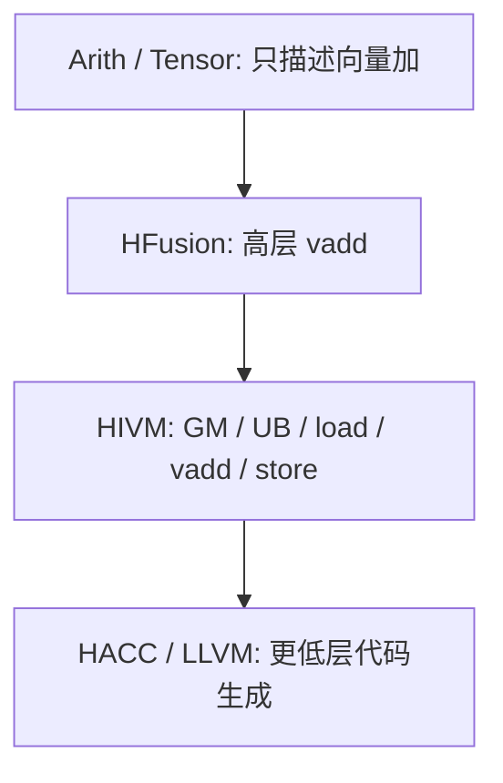

# Codex 执行方案：Assignment 1 进阶部分——AscendNPU IR 最小闭环探索

> 任务性质：第一次作业进阶要求，仅占 1 分。  
> 目标不是完整部署昇腾开发栈，也不是上板运行，而是完成一个**规模受控、逻辑完整、证据真实、能够写进报告**的 MLIR / AscendNPU IR 中端探索。
>
> 本任务采用：
>
> ```text
> 官方 VecAdd 主线理解
> +
> 1～2 个真实 HIVM Pass 实验（环境允许时）
> +
> 完整的 Before / After / 原因分析
> ```
>
> 若源码构建成本明显过高，则立即退化为“官方资料 + 真实源码/Test Case 分析”，不要为了 1 分任务继续投入大量时间配置 CANN 或昇腾硬件环境。

---

## 一、任务边界

### 1. 必须完成

最终要形成一个可以独立讲清楚的故事：

```text
高层 VecAdd
    ↓
MLIR 使用多级 Dialect 保留不同抽象层次
    ↓
HFusion 保留较高层算子语义
    ↓
HIVM 引入 NPU 硬件概念
    ↓
GM / UB
load / vadd / store
显式内存管理与同步
    ↓
再继续 Lowering 到更低层表示
```

同时至少完成一种“真实探索证据”：

```text
方案 A（优先）
实际构建 bishengir-opt
+
运行 1～2 个官方 HIVM Pass Test Case
+
保存 Before / After
```

如果构建条件不满足：

```text
方案 B（允许）
官方 VecAdd
+
官方 Pass 文档
+
仓库中真实 Test Case / RUN 命令
+
逐层结构分析
```

### 2. 明确不做

不要：

```text
安装完整 CANN
配置 Ascend 驱动
寻找真实 NPU
上板运行
构建 kernel.o 后继续 runtime 注册
搭完整 PyTorch → HFusion → HIVM 端到端链
为追求完整而修改现有编译原理主环境
```

原因：

```text
进阶任务只有 1 分，
老师允许环境困难时以文档与方言设计探索为主。
```

---

## 二、需要回答的核心问题

整个进阶部分只围绕以下四个问题组织。

### 1. 为什么需要 MLIR，而不能只靠 LLVM IR？

回答方向：

```text
不同优化需要不同抽象层次。

高层：
保留 tensor / operator 语义
适合 fusion / scheduling / tiling

低层：
逐步暴露内存、计算核、同步等硬件细节
适合 hardware mapping
```

不要简单写：

```text
MLIR 有很多 IR
LLVM 只有一个 IR
```

必须解释“为什么多层有价值”。

### 2. VecAdd 在不同层次发生了什么变化？

统一采用：

```text
VecAdd
```

作为贯穿案例。

概念主线：

```text
Arith / Tensor
    ↓
HFusion
    ↓
HIVM
    ↓
HACC / LLVM Lowering
```

但真正重点只放在：

```text
HFusion
    ↓
HIVM
```

这一段。

核心变化：

```text
高层：
vadd(a, b, c)

↓ Lowering

低层：
GM(a) → load → UB(a)
GM(b) → load → UB(b)

UB(a) + UB(b)
    ↓
   vadd
    ↓
  UB(c)

UB(c) → store → GM(c)
```

### 3. 为什么 HIVM 要引入 GM / UB / 显式搬运？

需要解释 NPU 的硬件特点：

```text
数据不只是“一个值”

还必须知道：
数据放在哪里
什么时候搬到片上
在哪里计算
什么时候同步
什么时候写回
```

因此：

```text
hfusion.vadd
```

下降为：

```text
memref.alloc
hivm.hir.load
hivm.hir.vadd
hivm.hir.store
```

不是“把一个指令拆成几个指令”这么简单，而是：

```text
把原来隐含的硬件执行策略
显式编码进 IR
```

### 4. 我们实际探索了什么？

报告必须明确区分：

```text
资料理解
vs
真实运行
```

如果真实运行 Pass：

```text
输入 IR
↓
运行什么 Pass
↓
Before
↓
After
↓
具体变化
↓
为什么这种变化符合 NPU 硬件需求
```

如果没有真实运行：

明确写：

```text
本部分为基于官方文档、官方源码 Test Case
以及课程材料进行的结构分析，
未声称完成真实 NPU 上板实验。
```

禁止伪造运行结果。

---

## 三、目录结构

在：

```text
assignment1/mlir/
```

建立：

```text
mlir/
├── README.md
│
├── sources/
│   ├── vecadd_hivm.mlir
│   └── selected_tests/
│
├── outputs/
│   ├── plan_memory_before.mlir
│   ├── plan_memory_after.mlir
│   ├── sync_before.mlir
│   └── sync_after.mlir
│
├── logs/
│   ├── environment.log
│   ├── build.log
│   └── pass_runs.log
│
├── analysis/
│   ├── lowering_chain.md
│   ├── plan_memory_analysis.md
│   └── sync_analysis.md
│
└── references/
    └── source_index.md
```

如果某实验未实际执行，对应 `outputs/` 文件不要伪造。

---

## 四、Stage 0：只读环境检查

### 目标

判断是否值得源码构建 AscendNPU IR。

不要安装东西。

### 执行

记录：

```bash
{
    echo "===== SYSTEM ====="
    cat /etc/os-release
    uname -m

    echo
    echo "===== BUILD TOOLS ====="
    cmake --version || true
    ninja --version || true
    clang --version | head -n 1 || true
    git --version || true
} | tee mlir/logs/environment.log
```

### 当前官方源码构建最低关注项

检查：

```text
CMake >= 3.28
Ninja >= 1.12
Clang >= 10
```

### 决策

如果全部满足：

```text
进入 Stage 1A：尝试源码构建
```

如果 CMake / Ninja 不满足：

不要：

```text
sudo apt upgrade
覆盖系统 cmake
替换系统 ninja
大规模修改现有环境
```

先检查是否已有：

```text
pipx
python venv
用户目录工具
```

可以非常低成本提供新版工具。

如果升级需要明显修改系统环境，则：

```text
停止源码构建路线
进入 Stage 1B
```

并在：

```text
mlir/README.md
```

记录：

```text
源码构建前置版本不满足；
考虑任务权重与环境稳定性，
本次进阶任务采用官方资料和源码 Test Case 分析路线。
```

---

## 五、Stage 1A：低成本尝试构建 AscendNPU IR

> 只有 Stage 0 判断成本低时执行。

### 1. 位置

不要放进现有 RISC-V 工具目录。

使用独立位置，例如：

```text
~/projects/Compiler-Labs/third_party/ascendnpu-ir
```

或：

```text
assignment1/mlir/vendor/ascendnpu-ir
```

如果加入 coursework Git 仓库：

```text
vendor/
```

必须加入 `.gitignore`，不要提交整个上游源码。

### 2. 获取源码

优先按照当前官方文档：

```bash
git clone https://gitcode.com/Ascend/ascendnpu-ir.git
cd ascendnpu-ir
git submodule update --init --recursive
```

记录：

```bash
git rev-parse HEAD
```

保存具体 commit。

### 3. 构建原则

以仓库当前：

```text
README
官方 Build and Installation
build-tools/build.sh --help
```

为准。

不要把 PPT 中可能过时的命令机械复制过来。

优先目标只有：

```text
bishengir-opt
```

不要求：

```text
CANN Runtime
bishengir-compile 完整端到端
kernel.o 上板运行
```

### 4. 构建留痕

所有输出：

```text
mlir/logs/build.log
```

如果构建开始引入：

```text
完整 CANN
Ascend Driver
硬件 SDK
大量额外系统改动
```

立即停止。

记录：

```text
构建超出本任务合理范围
```

转 Stage 1B。

---

## 六、Stage 1B：资料 / 源码分析路线

> 如果 Stage 1A 不值得继续，直接走这里。

### 目标

保证即使不构建工具，也有真实、可验证的技术依据。

### 使用资料优先级

```text
1. 作业 PPT 的进阶要求
2. AscendNPU IR 官方 Quick Start VecAdd
3. 官方 Architecture 文档
4. 官方 HIVM Pass 文档
5. 官方源码仓库中的真实 Test Case
```

不要优先使用博客二手解释。

### 需要保存的来源索引

建立：

```text
mlir/references/source_index.md
```

记录：

```text
资料名称
官方页面
查询日期
用于解释什么
```

---

## 七、Stage 2：固定 VecAdd 基准

### 目标

只选择一个足够小的核心案例。

使用官方 Quick Start 中的：

```text
16 × int16 VecAdd
```

语义：

```c
for (int i = 0; i < 16; i++)
    c[i] = a[i] + b[i];
```

### 1. 保存 HIVM 版本

从官方 Quick Start 获取并保存为：

```text
mlir/sources/vecadd_hivm.mlir
```

不要自行修改 Op 名字来“让它更漂亮”。

### 2. 分析结构

至少标注：

```text
arg0 / arg1 / arg2
    ↓
GM 地址空间

三个 memref.alloc
    ↓
UB 地址空间

load
    ↓
GM → UB

vadd
    ↓
UB 上计算

store
    ↓
UB → GM
```

输出：

```text
mlir/analysis/lowering_chain.md
```

---

## 八、Stage 3：建立最小 Lowering 主线

这个阶段不要求真实跑完整链。

根据课程 PPT + 官方资料建立：

```text
Level 0
Arith / Tensor

    ↓

Level 1
HFusion

    ↓

Level 2
HIVM

    ↓

后续
HACC / LLVM
```

### 重点只比较三层

#### Level 0

表达：

```text
“两个 tensor 相加”
```

硬件信息：

```text
无
```

#### Level 1：HFusion

表达：

```text
高层 vadd 算子
```

仍保留：

```text
operator / tensor 级语义
```

便于：

```text
Fusion
Scheduling
Tiling
Vectorization
```

#### Level 2：HIVM

开始出现：

```text
GM
UB
load
vadd
store
memory planning
sync
```

这是本任务重点。

### 输出

```text
mlir/analysis/lowering_chain.md
```

建议生成一张 Mermaid：



---

## 九、Stage 4：真实 Pass 实验 1——PlanMemory

> 如果 `bishengir-opt` 成功构建，则执行。  
> 如果没有构建成功，则使用官方真实 Test Case + Pass 文档完成结构分析。

### 为什么选 PlanMemory

这是本次最值得做的真实 Pass。

因为它正好连接：

```text
“我需要一块 UB”
```

与：

```text
“具体怎么给这块 UB 分配地址”
```

### 1. 不自己猜命令

在 AscendNPU IR 仓库中搜索：

```bash
grep -R --line-number \
    "hivm-plan-memory" \
    test tests 2>/dev/null | head -n 30
```

或：

```bash
grep -R --line-number \
    "RUN:.*hivm-plan-memory" \
    . | head -n 30
```

选择一个：

```text
足够小
输入 IR 可读
输出变化明显
```

的官方测试。

### 2. 使用官方 Test Case 的 RUN 命令

不要自行拼接目标芯片参数。

从测试文件：

```text
// RUN: ...
```

提取真实 `bishengir-opt` 调用方式。

把：

```text
输入
命令
Before
After
```

全部保存。

### 3. 输出文件

```text
mlir/sources/selected_tests/plan_memory_input.mlir
mlir/outputs/plan_memory_before.mlir
mlir/outputs/plan_memory_after.mlir
mlir/logs/pass_runs.log
mlir/analysis/plan_memory_analysis.md
```

### 4. 分析只回答三件事

```text
Pass 前缺少什么信息？
Pass 后增加/改变了什么？
为什么 NPU 需要做这个转换？
```

不要大篇幅复述算法实现。

---

## 十、Stage 5：真实 Pass 实验 2——同步

> 若 PlanMemory 已经足以形成完整内容，Stage 5 可以视时间决定是否执行。
>
> 如果第二个实验导致明显额外复杂度，可以直接停止，只有 PlanMemory 一个真实 Pass 也可以接受。

### 1. 优先 Pass

查找：

```text
-hivm-inject-sync
```

或当前仓库对应的小型同步 Test Case。

搜索：

```bash
grep -R --line-number \
    "RUN:.*hivm-inject-sync" \
    . | head -n 30
```

如果当前版本更推荐 GraphSyncSolver 相关测试，则以仓库真实测试为准。

### 2. 目标

观察：

```text
数据搬运
↓
计算
```

之间为什么需要显式同步。

重点不是把所有同步机制学完，而是说明：

```text
NPU 流水并行
+
不同硬件 pipeline
+
数据依赖
    ↓
不能仅靠源码顺序假定执行完成
    ↓
IR 需要显式表达同步
```

### 3. 输出

如果实际运行：

```text
mlir/sources/selected_tests/sync_input.mlir
mlir/outputs/sync_before.mlir
mlir/outputs/sync_after.mlir
mlir/analysis/sync_analysis.md
```

如果没有实际运行：

```text
只生成 sync_analysis.md
```

并明确说明：

```text
本部分基于官方 Pass 文档 / Test Case 分析，
未实际执行。
```

---

## 十一、停止条件

这是一个 1 分任务。

Codex 必须主动控制范围。

出现以下任一情况时：

```text
需要安装完整 CANN
需要 Ascend 驱动
需要真实 NPU
需要修改系统级 LLVM
需要大量 patch 才能构建
第三方依赖下载/编译预计明显耗时
连续遇到与作业核心无关的构建问题
```

立即停止继续扩展。

不要为了：

```text
“把整条链跑通”
```

消耗大量时间。

此时保证：

```text
VecAdd 主线完整
+
PlanMemory / Sync 至少有官方源码证据
+
分析自洽
```

即可。

---

## 十二、最终报告需要形成的内容

最后进阶部分建议只占报告约：

```text
1～2 页正文
+
1～2 张关键图
```

不要扩成独立大论文。

### 建议结构

#### 1. MLIR 与 LLVM IR 的抽象差异

简洁解释：

```text
LLVM IR 更低层
MLIR 可以让多个 Dialect 表达不同抽象层级
```

重点说明：

```text
为什么不同优化需要不同抽象层级
```

#### 2. AscendNPU IR 的 VecAdd Lowering

用一张图：

```text
Arith / Tensor
    ↓
HFusion
    ↓
HIVM
```

说明：

```text
高层语义逐渐转化为硬件执行语义
```

#### 3. HIVM 中的硬件映射

重点展示：

```text
GM
↓ load
UB
↓ vadd
UB
↓ store
GM
```

解释：

```text
硬件信息何时进入 IR
```

#### 4. 实际 Pass 探索

优先写：

```text
PlanMemory
```

格式：

```text
Before
↓
Pass
↓
After
↓
变化解释
```

如果 Sync 也做了，再增加一小段。

#### 5. 小结

最后收束：

```text
MLIR 的价值不是“有很多种 IR”，
而是允许编译器在合适的抽象层级完成合适的优化，
并逐步、显式地引入 NPU 的存储和执行约束。
```

---

## 十三、必须保留的证据

最终至少需要：

```text
[ ] 环境检查日志

[ ] 官方 VecAdd HIVM 输入

[ ] lowering_chain.md

[ ] 官方来源索引

[ ] PlanMemory Test Case 来源

[ ] PlanMemory Before / After
    或明确标注为源码结构分析

[ ] PlanMemory 分析

[ ] 若完成 Sync：
    Sync Before / After + 分析

[ ] README.md 说明本次实际执行范围
```

---

## 十四、README.md 必须声明“做了什么 / 没做什么”

`assignment1/mlir/README.md` 最终必须明确写：

```text
本次任务完成：
- VecAdd 多级 IR 主线分析
- HFusion → HIVM 的核心语义变化解释
- HIVM GM/UB/load/vadd/store 结构分析
- PlanMemory Pass 的真实运行或官方 Test Case 分析
- 可选 Sync Pass 分析

本次任务未完成：
- 完整 CANN 部署
- kernel.o 上板执行
- 真实 Ascend NPU Runtime 验证

原因：
进阶任务目标是观察 MLIR 中端 lowering；
上述内容已足以形成完整、可验证的中端探索闭环。
```

---

## 十五、Codex 最终交付

完成后输出：

```text
records/08_mlir_exploration.md
```

并在文件末尾增加：

```markdown
## 完成状态

- VecAdd 主线：PASS
- 官方资料核对：PASS
- bishengir-opt 构建：PASS / SKIPPED / FAIL
- PlanMemory 实验：PASS / ANALYSIS-ONLY
- Sync 实验：PASS / ANALYSIS-ONLY / SKIPPED
- CANN：NOT ATTEMPTED
- NPU 上板：NOT ATTEMPTED
```

然后向用户只汇报：

```text
1. 实际完成到什么程度
2. 哪些是真实运行结果
3. 哪些是资料/源码分析
4. 有无阻塞问题
5. 哪些文件可以直接用于最终报告
```

不要因为没有上板而把任务标成失败。

---

## 十六、执行优先级

严格按照：

```text
Stage 0
环境检查
    ↓
Stage 1
低成本判断能否构建 bishengir-opt
    ↓
Stage 2
固定官方 VecAdd
    ↓
Stage 3
完成 lowering 主线
    ↓
Stage 4
PlanMemory（最优先真实实验）
    ↓
Stage 5
Sync（有余力再做）
    ↓
Stage 6
整理证据
    ↓
records/08_mlir_exploration.md
```

其中：

```text
Stage 4 完成以后，
如果内容已经足够自洽，
允许直接收尾。
```

不要继续为了“完整度”扩展到 CANN / NPU。

---

## 十七、最重要的执行原则

本任务的成功标准不是：

```text
跑得越多越好
```

而是：

```text
选一个足够小的 VecAdd
        ↓
解释清楚为什么要多级 IR
        ↓
解释清楚硬件细节如何进入 HIVM
        ↓
用一个真实 Pass 展示 IR 确实会继续发生变化
        ↓
保存证据
        ↓
形成一段可以独立写进报告的完整分析
```

做到这里即停止。
