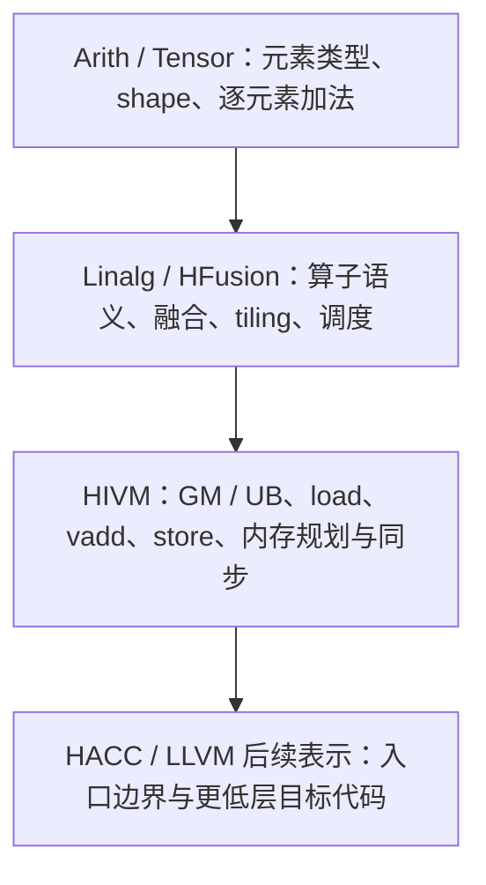

# VecAdd 的多层表示

基准语义固定为 16 个 `int16` 元素：`c[i] = a[i] + b[i]`。本地保存的 [HIVM 输入](../sources/vecadd_hivm.mlir)来自官方 `add.mlir`。



## 为什么保留多层 IR

不同阶段需要不同的信息。张量形状与算子边界还在时，编译器更容易识别逐元素运算、融合算子、选择 tile 并安排并行执行。若一开始就只保留普通低层 load/store 和算术指令，算子与张量结构会被摊平，后续优化难以直接利用这些语义。

当 lowering 进入 HIVM，编译器需要决定数据在哪里、如何搬运、在哪个执行单元计算。HIVM 因此显式带有内存空间和 NPU 操作。MLIR 的价值在于编译器可在同一 IR 基础上逐步改写这些层次，让每类优化在它需要的信息仍然存在时执行。LLVM IR 适合作为更低层的通用表示；它不会替代前面面向张量和 NPU 的专用语义。

## 同一 VecAdd 在 HIVM 中

官方样例的三个输入输出参数 `%arg0`、`%arg1`、`%arg2` 都位于 GM。编译器把 A、B、C 的暂存结果放进 UB：

```text
GM(arg0) ──load──▶ UB(alloc)
GM(arg1) ──load──▶ UB(alloc_0)
                    │
                    └── hivm.hir.vadd ──▶ UB(alloc_1)
                                            │
                                            └── store ──▶ GM(arg2)
```

这里 `memref.alloc` 不只是抽象临时值：其类型包含 `#hivm.address_space<ub>`，输入输出参数包含 `<gm>`。`hivm.hir.load` / `store` 表示片上与全局内存之间的数据移动，`hivm.hir.vadd` 表示 UB 上的向量计算。lowering 把原先隐含的存储位置与搬运策略变成可分析、可规划的 IR。

## 观察范围

官方框架文档描述 Torch 经 Linalg/HFusion 到 HIVM 的多层接入；本地 VecAdd 文件直接展示 HIVM 层。当前公开材料没有随本次环境提供一次 HFusion → HIVM 的本地转储，也没有保存该例的 LLVM IR dump。因此上面的层次图是根据官方架构资料和作业要求整理的概念主线；可逐行核对的实际源文件是 HIVM VecAdd，不把概念图说成一次完整编译实验结果。

`hacc.entry` 与 `hacc.function_kind<DEVICE>` 标记设备 kernel 入口和执行侧。官方示例 README 另外展示 host wrapper 如何准备数据、编译 kernel `.o` 并启动；本轮未执行这些构建和运行步骤。
